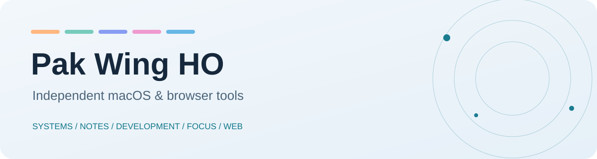
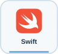
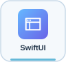
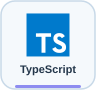

<picture>
  <source media="(prefers-color-scheme: dark)" srcset="assets/header-dark.svg">
  
</picture>

[English](README.md) · [繁體中文](README.zh-Hant.md) · [**简体中文**](README.zh-Hans.md)

我开发独立的 macOS 与浏览器工具，让日常工作更容易找到、完成和整理。

[↗ 交互作品集与履历](https://impatrickho.vercel.app/) · [源代码](https://github.com/yoko1234p/impatrickho)

## 精选工具

## 我使用的技术

这里结合了公开项目、[工作经验](https://impatrickho.vercel.app/)和我使用的开发工具。项目图标链接到代码；职业技能链接到[履历资料](https://github.com/yoko1234p/impatrickho/blob/main/constants.ts)。

### 原生应用与自动化

### 网页与手机

### 云端、部署与 AI

[履历](https://github.com/yoko1234p/impatrickho/blob/main/constants.ts)还记录了 Java、PHP、MySQL、Adobe AEM、Tailwind CSS 和 Sass。

### 代表性实现

- **CaptureText：**本机 OCR 与表格识别，连接屏幕捕获及导出流程。[OCR 源代码](https://github.com/yoko1234p/CaptureText/blob/main/DeskTools/Sources/CaptureCore/Recognition.swift) · [表格源代码](https://github.com/yoko1234p/CaptureText/blob/main/DeskTools/Sources/CaptureCore/TableRecognition.swift)
- **BarPilot：**菜单栏图标盘点、定位及按屏幕配置布局。[盘点源代码](https://github.com/yoko1234p/BarPilot/blob/main/BarPilot/Sources/BarPilot/MenuBarInventory.swift) · [定位源代码](https://github.com/yoko1234p/BarPilot/blob/main/BarPilot/Sources/BarPilot/MenuBarPositionService.swift)
- **TG Local：**Telegram Web 媒体控制与有条件的断点续传，并通过浏览器测试验证。[下载源代码](https://github.com/yoko1234p/TGLocal/blob/main/src/downloads.js) · [浏览器测试](https://github.com/yoko1234p/TGLocal/blob/main/tests/extension.spec.mjs)
- **网页作品集：**React／TypeScript 交互界面，包含 3D 场景和动画设计。[网站](https://impatrickho.vercel.app/) · [应用源代码](https://github.com/yoko1234p/impatrickho/blob/main/App.tsx) · [场景源代码](https://github.com/yoko1234p/impatrickho/blob/main/components/Scene3D.tsx)

## 探索应用

| 系列 | 项目 | 用途 |
|:--|:--|:--|
| **系统效率** | | |
| | [BarPilot](https://github.com/yoko1234p/BarPilot) | 整理菜单栏图标与多屏幕布局。 · [↓ 预览版](https://github.com/yoko1234p/BarPilot/releases/tag/v0.5.2-preview.1) |
| | [QuickSwitch](https://github.com/yoko1234p/QuickSwitch) | 系统开关、保持唤醒计时与配置。 · [↓ 预览版](https://github.com/yoko1234p/QuickSwitch/releases/tag/v0.4.0-preview.1) |
| | [SuperPilot](https://github.com/yoko1234p/SuperPilot) | Finder 操作、批量重命名与快捷键。 · [↓ 预览版](https://github.com/yoko1234p/SuperPilot/releases/tag/v0.4.4-preview.1) |
| **文字与笔记** | | |
| | [CaptureText](https://github.com/yoko1234p/CaptureText) | 屏幕 OCR、朗读与表格导出。 · [↓ 预览版](https://github.com/yoko1234p/CaptureText/releases/tag/v0.9.0-preview.1) |
| | [EdgeNotes](https://github.com/yoko1234p/EdgeNotes) | 侧边笔记、行内图片与文字计算。 · [↓ 预览版](https://github.com/yoko1234p/EdgeNotes/releases/tag/v0.8.0-preview.1) |
| | [SelectionBar](https://github.com/yoko1234p/SelectionBar) | 选中文字操作与扩展。 · [↓ 预览版](https://github.com/yoko1234p/SelectionBar/releases/tag/v0.5.2-preview.1) |
| **开发工具** | | |
| | [DevWorkbench](https://github.com/yoko1234p/DevWorkbench) | 离线格式整理、转换与数据遮蔽。 · [↓ 预览版](https://github.com/yoko1234p/DevWorkbench/releases/tag/v0.6.0-preview.1) |
| **专注与学习** | | |
| | [NotchHub](https://github.com/yoko1234p/NotchHub) | 刘海工作台、专注计时、日历与词汇。 · [↓ 预览版](https://github.com/yoko1234p/NotchHub/releases/tag/v0.3.0-preview.1) |
| **网页与媒体** | | |
| | [TGLocal](https://github.com/yoko1234p/TGLocal) | Telegram Web 媒体操作及可辨认下载。 · [↓ 预览版](https://github.com/yoko1234p/TGLocal/releases/tag/v0.5.0-preview.1) |

## 从这里开始

每个项目均有独立源代码、构建步骤和预览版下载。macOS 预览版使用临时签名，未经 Apple 公证；请按各仓库的安装说明操作。TG Local 是通过开发者模式加载的 Chrome 扩展。

## 参与开发

请到相关项目提交 Issue，注明 macOS 或 Chrome 版本、复现步骤及实际情况。原创应用代码采用 GPL-3.0-only；第三方素材保留各自许可声明。
